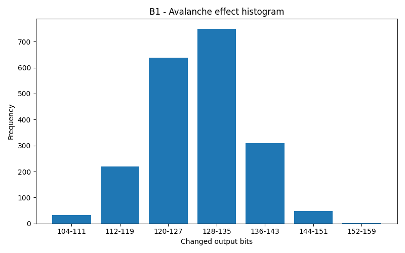

# Hash_Functions_and_Password_Storage

This practice forms part of the subject Cryptography for the Bachelor in Data Science and Engineering, CEU San Pablo University 26/27. It focuses on implementing the SHA-256 cryptographic hash function from the FIPS 180-4 specification, measuring its security properties, exploring length-extension attacks against message authentication codes, and studying password storage vulnerabilities.

## 1. How to run everything

The project is implemented in Python 3.11+ and it is organized into independent files, each responsible for a different cryptographic task. All modules are tested from the terminal using the automated test suite.

To run the automated tests:
```bash
python -m unittest discover -s tests
```
To verify the SHA-256 implementation from part A, run:
```bash
python -c "from sha256 import sha256; print(sha256(b'abc').hex())"
```
Expected output:
```bash
ba7816bf8f01cfea414140de5dae2223b00361a396177a9cb410ff61f20015ad
```
To run the avalanche effect and birthday bound experiments
from Part B, install matplotlib and run:

```bash
python -m pip install matplotlib
python measure.py
```

The program displays the experimental measurements,
calculates the fitted slope and saves both plots in
the `images/` directory.

To run the MAC and HMAC implementations from Part C:
```bash
python mac.py
```
To run the length-extension experiment from Part C1:
```bash
python forge.py

```
To run the password storage experiment from Part D:
```bash
python crack.py
```

## 2. A3 - Resuming from a known state

### Question
*State in two lines why the second and third bullets agree, and what that tells you about what a SHA-256 digest reveals.*

### Explanation
Both results agree because the SHA-256 digest contains the internal state after processing the original message and its padding, allowing the algorithm to continue from that state. 

This means that knowing a SHA-256 digest and the original message length makes it possible to extend the hashed message without knowing its original contents.

### Verification
Using `base = b"the first part"` and `suffix = b"and the rest"`, the original digest is:
```bash
d2bba6892bc661a48fd99f726bdf084a4e53e9644d03f06002eb2c1d11ac194d
```

Resuming SHA-256 from that digest with `already = 64` produces:
```bash
cb32e653bcd5ed0800832787b264fab57a61f652a391177224fa3cbb1aab740d
```
This matches the result of hashing `base + padding(len(base)) + suffix` directly. 

## 3. B1 - The avalanche effect

### Measurements

The experiment was performed by generating random messages, flipping a single random bit and counting the number of different bits between the original and modified SHA-256 digests.

| Parameter | Value |
|---|---:|
| Number of trials | 2000 |
| Message length | 32 bytes |
| Random seed | 20357 |
| Mean | 128.2795 bits |
| Minimum | 105 bits |
| Maximum | 158 bits |
| Theoretical mean | 128 bits |
| Absolute deviation | 0.2795 bits |

Histogram with 8-bit bins:



| Bin | Count |
|---|---:|
| 104-111 | 33 |
| 112-119 | 220 |
| 120-127 | 639 |
| 128-135 | 750 |
| 136-143 | 309 |
| 144-151 | 48 |
| 152-159 | 1 |

### Question
*State the value theory predicts and how far your mean is from it.*

### Explanation

For an ideal 256-bit hash function, changing a single input bit should change each output bit with a probability of 50%. Therefore, the theoretical mean is 256 × 0.5 = 128 bits.

The measured mean is 128.2795 bits, which is only 0.2795 bits above the theoretical value (a relative deviation of 0.2184%). These results are consistent with the expected avalanche effect of SHA-256.

## 4. B2 - The birthday bound

### Measurements

The experiment was performed by truncating SHA-256 to
different output lengths and hashing consecutive decimal
strings until the first collision was found.

Collision table for 16, 20, 24, 28, 32 and 36 bits:

| Bits | First string | Second string | Hashes computed | Prediction | Ratio |
|---:|---:|---:|---:|---:|---:|
| 16 | 157 | 251 | 252 | 320.85 | 0.7854 |
| 20 | 270 | 1877 | 1878 | 1283.39 | 1.4633 |
| 24 | 4163 | 8864 | 8865 | 5133.57 | 1.7269 |
| 28 | 16095 | 23815 | 23816 | 20534.30 | 1.1598 |
| 32 | 69235 | 95303 | 95304 | 82137.20 | 1.1603 |
| 36 | 63964 | 393644 | 393645 | 328548.78 | 1.1981 |


Plot log₂(hashes) against n, fit a straight line and report the measured slope:


| Parameter | Value |
|---|---:|
| Measured slope | 0.510484 |
| Theoretical slope | 0.5 |
| Absolute deviation | 0.010484 |
| Relative deviation | 2.10% |


### Question
*State what you measured, what the theory predicts, and whether a single measurement per width is enough to tell them apart.*

### Explanation

According to the birthday bound, the expected number of
hashes required to find a collision is approximately
sqrt(pi/2) × 2^(n/2). Therefore, the theoretical slope
of log2(hashes) against the output length is 0.5.

The measured slope is 0.510484, which is close to the
theoretical value. This means that each additional output
bit increases the collision resistance by approximately
half a bit of computational work.

A single measurement per width is not sufficient to
establish a statistically significant difference between
the measured and theoretical slopes, since collision
searches have natural statistical variability.

Multiple independent experiments per width would be
necessary to obtain more reliable estimates. The measured
results are consistent with the birthday bound.

## 5. C1 - The forgery

### Results

The server challenge was:

- message: `user=student&role=guest&expires=2026-12-31`
- tag: `7daa0c342759f55c15bd8acc4a97b17f0adf1dad91e6b862cb0050afbdd92824`
- key length: 18 bytes
- target suffix: `&role=admin`

`forge()` computes the glue padding the server itself would have appended
when hashing `key || msg` (based on the total length `keylen + len(msg)`),
resumes SHA-256 from the state encoded in the given tag, and hashes only
the suffix from there.

| Parameter | Value |
|---|---:|
| Glue padding bytes | 68 |
| Extended message length | 121 bytes |

Extended message (hexadecimal):
```
757365723d73747564656e7426726f6c653d677565737426657870697265733d323032362d31322d333180000000000000000000000000000000000000000000000000000000000000000000000000000000000000000000000000000000000000000000000000000000000001e026726f6c653d61646d696e
```

Forged tag:
```
b0464fec2a6ca6532b99e20da7f485d4ca0fb3ac10d39e0746d4c243b119d4d0
```

This was verified against `naive_verify` with a self-chosen 18-byte key
in `tests/test_mac.py` (`test_forgery_verifies_with_chosen_key`), since
the real server key is never available to us — the attack's correctness
depends only on the key *length*, not its value.

### Question
*What would you do if the key length had not been given to you?*

### Explanation
Without the key length, the attacker does not know where to place the
glue padding or how many bytes `state_from_digest` has already absorbed,
so a single candidate forgery is not enough. The fix is to try every
plausible key length one at a time (for example 1 to 64 bytes, or
whatever range is reasonable for the system), computing `forge()` and
submitting the resulting message to the server for each guess. Only the
guess that matches the real key length produces a glue padding aligned
with the one the server actually used when it first hashed `key || msg`,
so only that one message is accepted — every other guess is rejected.
This turns a single forgery into a brute-force search over key lengths,
which is still cheap: it costs one SHA-256 call and one server request
per candidate length, not per key value.

## 6. C2 - HMAC

### Results
`hmac_sha256()` was verified against the three published RFC 4231
vectors (keys `0x0b`×20, `"Jefe"`, `"secret"`), all matching exactly —
see `tests/test_mac.py::TestC2Hmac::test_rfc4231_vectors`.

The same C1 attack was then run against an HMAC tag of the message
`user=student&role=guest` with an 18-byte key, attempting to append
`&role=admin`. The forged tag does **not** verify
(`test_length_extension_fails_against_hmac`): `hmac_verify` returns
`False` for the extended message.

### Question
*Explain why the outer hash in HMAC prevents the length-extension attack.*

### Explanation
HMAC is `H(opad⊕key || H(ipad⊕key || msg))`. An attacker who only sees
the final tag knows the *output* of the outer hash, but that output is
not itself a usable internal state: to extend it, the attacker would
need to resume SHA-256 from the state `H(opad⊕key || ...)` encodes,
which requires knowing `opad⊕key` — the exact bytes absorbed before the
inner digest. That value depends on the secret key and is never
revealed by the tag. In the naive MAC, by contrast, the tag *is*
directly the internal state after absorbing `key || msg`, so resuming
from it needs no secret at all, only the key's length. The outer hash
in HMAC breaks that property: there is no secret-free way to continue
hashing past it.

## 7. D1 - Password Storage

### Measurements
[TO DO - Eight recovered passwords]
[TO DO - Dictionary size, total number of hashes computed and execution time]
[TO DO - Database row for password 123456 without salt]
[TO DO - Database rows for password 123456 with salts a3f1c0d94e2b7865 and 7b2e4f81cc09a512]

### Question
*How many hashes would an attacker need against a database of 500 users with a per-user salt, compared with the number actually computed? Which attack does salting prevent, and which does it not prevent?*

### Explanation
[TO DO]

## 8. Secure Primitive vs. Secure Construction

### Question
*Part A built a hash that passes every test in the handout. Part C broke a MAC built from it without finding a single collision. Explain what this says about the difference between a secure primitive and a secure construction.*

### Explanation
[TO DO]

## 9. Limitations and Observations
[TO DO]

## 10. AI Assistance
[TO DO]